<div align="center">



<a href="https://github.com/maiviet283">
  
</a>

<br/>

<a href="https://maiviet283.github.io"></a>
<a href="https://linkedin.com/in/maiviet283"></a>
<a href="mailto:maiviet283@gmail.com"></a>


</div>

<br/>



## ⚡ Impact in numbers


## 🧭 Experience

<table>
<tr>
<td width="140" valign="top"><code>06/2026 → now</code></td>
<td>

**Full-Stack Developer & Team Lead** · BNH Digital <sub>🇦🇺 Australia-based agency · remote</sub>

- Lead a **3-person engineering team** — requirements → technical design → DB schema → sprint plan → review of every PR.
- Shipped **6 production web & mobile apps in 5 months** across healthcare, accounting & tax SaaS and F&B retail.
- Set the team's standards: **6,000+ automated tests**, CI on every repo, OpenAPI docs for every API.
- Run production for all client apps: Docker on VPS, Cloudflare in front, Sentry, **blue-green zero-downtime releases**.

</td>
</tr>
<tr>
<td valign="top"><code>03 → 05/2026</code></td>
<td>

**Backend Developer** · SapotaCorp

- Shipped features & fixes for the **AttituX HR Platform (.NET)** — auth, profile and admin modules, plus internal admin tools.

</td>
</tr>
<tr>
<td valign="top"><code>09 → 12/2025</code></td>
<td>

**Backend Intern** · Rikai Technology

- Built routing modules for a **nationwide route-finding system in Japan** (FastAPI · GeoPandas · pgRouting).
- Cut route computation **33s → 1.2s (~27× faster)** by reworking algorithms, schemas, indexes and pgRouting queries.
- Migrated services from **sync → async in 3 days**, raising throughput under load.

</td>
</tr>
</table>

## 🚀 Featured work

<table>
<tr>
<td width="50%" valign="top">

### 🩺 Haven
**Home-doctor visits & family health platform**<br/>
<sub>Co-founder & Lead Engineer · 09/2026 → now</sub>

Built the whole product solo: Astro website, a **14-module Django REST API**, an ops admin for staff, and a React Native app for patients & doctors.

- Radius-based doctor search · doctor KYC · booking lifecycle with automated reminders · VietQR payments
- AI food recognition with **Gemini** + a 566-exercise fitness library
- 2FA admin · OTP & Google/Apple sign-in · Celery on 4 queues · **2,000+ tests**


🔗 **[havenmed.vn](https://havenmed.vn)**

</td>
<td width="50%" valign="top">

### 📊 One Management System
**Sales, accounting & tax SaaS for Vietnamese SMEs**<br/>
<sub>Full-Stack Developer · 07 → 10/2026 · live since 11/2026</sub>

Built the full system in **~3.5 months**: a business web app, a Windows desktop app and an ops admin.

- **Multi-tenant** — one account runs many businesses, every API is tenant-scoped
- **~50 modules**: sales, e-invoices, tax filing, payroll, CRM, logistics, an AI legal assistant
- Celery + Beat for email, e-invoice, reports & backups · **4,000+ tests**


🔗 **[oms.com.vn](https://oms.com.vn)**

</td>
</tr>
<tr>
<td width="50%" valign="top">

### ☕ EightyTwenty
**Café-chain platform: back office, ordering app & POS API**<br/>
<sub>Backend Lead · runs daily across 10 stores in 🇦🇺 Australia</sub>

The Back Office System and the shared REST API behind the customer app, POS terminals and kitchen displays.

- **Idempotent orders + server-side pricing** — safe against retries & price tampering
- POS: PIN login, till shifts, refunds, live order feed to kitchen displays
- RBAC (owner / manager / staff) · audit log on every write · **300+ tests**


🔗 **[maiviet283/EightyTwenty](https://github.com/maiviet283/EightyTwenty)**

</td>
<td width="50%" valign="top">

### 💸 VietDon
**Real-time donation platform for streamers**<br/>
<sub>Founder & Developer · personal product · 02 → 11/2026</sub>

Built and ran it for 9 months — **200+ active users** and **~12M VND/month** in revenue.

- Pay2s QR payments processed asynchronously on Celery
- Live on-screen alerts via **Django Channels + WebSocket** (OBS-ready)
- Redis caching · Cloudflare R2 media · Docker + Nginx


</td>
</tr>
</table>

<details>
<summary><b>🔍 More on GitHub</b></summary>
<br/>

| Project | What it is |
|---|---|
| 🛡️ [**analyze_logs**](https://github.com/maiviet283/analyze_logs) | Network intrusion detection with Zeek + Elasticsearch + Python — flags DDoS, SQLi, XSS, brute-force and abnormal traffic |
| 🤖 [**poppy_assistant**](https://github.com/maiviet283/poppy_assistant) | Poppy — an AI receptionist for service businesses |
| 🛒 [**my_shop**](https://github.com/maiviet283/my_shop) | E-commerce API with DRF — JWT, Redis caching, brute-force protection, Nginx + Gunicorn deploy |
| 🌐 [**maiviet283.github.io**](https://github.com/maiviet283/maiviet283.github.io) | My portfolio site, built with Astro |

</details>

## 🛠️ Tech arsenal

<table>
<tr><td width="170"><b>Backend</b></td><td></td><td><sub>DRF · REST / OpenAPI · Celery + Beat · Django Channels · WebSocket</sub></td></tr>
<tr><td><b>Frontend & Mobile</b></td><td></td><td><sub>React Native (Expo) · Tauri v2 desktop apps</sub></td></tr>
<tr><td><b>Data</b></td><td></td><td><sub>PgBouncer · pgRouting · indexing & query tuning</sub></td></tr>
<tr><td><b>DevOps & Cloud</b></td><td></td><td><sub>VPS · Cloudflare DNS & R2 · Render · Sentry · CI/CD · blue-green deploys</sub></td></tr>
<tr><td><b>Security</b></td><td colspan="2"><sub>RBAC · 2FA · JWT / OAuth · tenant isolation · audit logging · rate limiting — <i>B.Eng. Information Security & Computer Networks</i></sub></td></tr>
</table>

## 🧠 How I build

```python
class HowIBuild:
    design   = "Schema first. Boring tech, clear boundaries, tenant-safe by default."
    quality  = "Tests on every project, CI on every repo, every PR reviewed — AI-written code included."
    perf     = "Measure, then fix the query. 33s → 1.2s is a habit, not a fluke."
    security = "2FA, RBAC, audit logs and idempotency aren't features — they're the floor."
    ops      = "If I ship it, I run it: Docker, Cloudflare, Sentry, zero-downtime releases."
```

## 🐍 Contribution snake

<div align="center">

<picture>
  <source media="(prefers-color-scheme: dark)" srcset="https://raw.githubusercontent.com/maiviet283/maiviet283/output/github-snake-dark.svg" />
  <source media="(prefers-color-scheme: light)" srcset="https://raw.githubusercontent.com/maiviet283/maiviet283/output/github-snake.svg" />
  
</picture>

</div>

## 🤝 Let's work together

I'm happy to talk about **backend / full-stack roles**, interesting system-design problems, or anything involving Django, PostgreSQL and making slow things fast.

<div align="center">

<a href="mailto:maiviet283@gmail.com"></a>
<a href="https://linkedin.com/in/maiviet283"></a>

<br/><br/>


</div>
